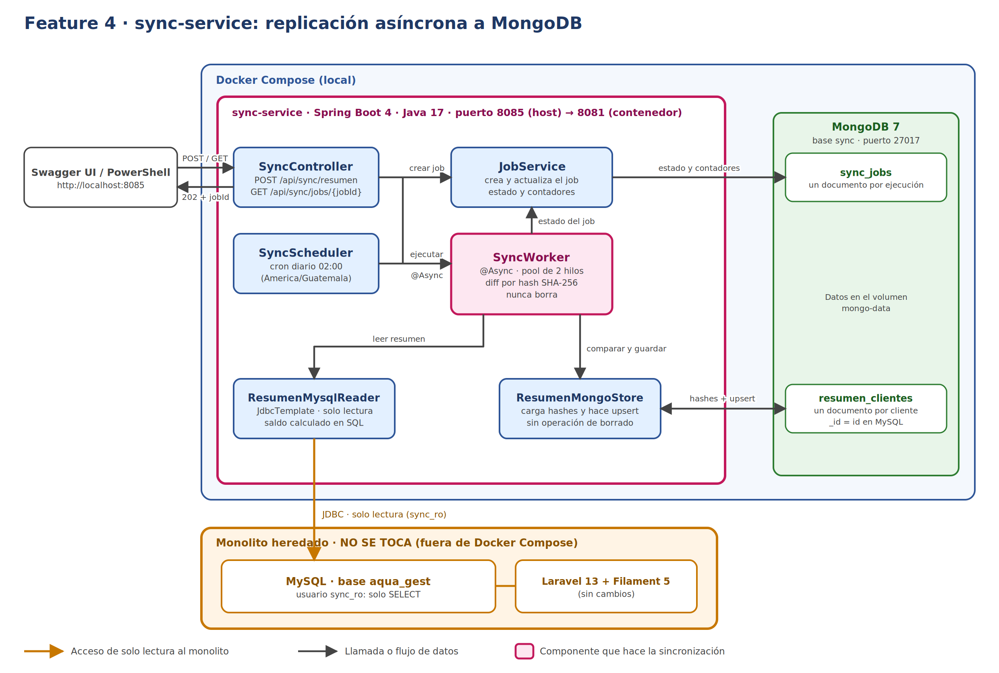

Nombre: Keven Ryan Lopez Pineda  
Carnet: 0905-23-4114  
Repositorio: https://github.com/Keven-lopez/sync-service  
Módulo asignado: Replicación asíncrona a NoSQL | SQL

# Oficina del Agua · Fase 2

Servicios de la Fase 2 que acompañan al sistema de gestión de agua potable (monolito Laravel + Filament). Este repositorio **no modifica el monolito**: los servicios nuevos viven aparte y leen su base de datos en modo solo lectura.

## Contenido

| Carpeta / archivo | Descripción |
|---|---|
| `docker-compose.yml` | Levanta los servicios de la Fase 2 en local (MongoDB y `sync-service`). El monolito y su MySQL quedan fuera de Docker |
| `syncservice/` | **Feature 4**: replicación asíncrona a NoSQL (Spring Boot + MongoDB) |

---

## Feature 4: sync-service

Servicio Spring Boot que copia un **resumen por cliente** desde la base de datos MySQL del monolito hacia MongoDB, sin bloquear a quien lo invoca.

```
Laravel + Filament + MySQL   (sin cambios, fuera de Docker)
          ▲  JDBC de solo lectura (usuario sync_ro)
          │
   sync-service (Spring Boot)  ──upsert──►  MongoDB
          ▲
   Swagger UI / PowerShell:  POST /api/sync/resumen
```

### Cómo funciona

1. `POST /api/sync/resumen` crea un job y responde **202 Accepted** con su `jobId` de inmediato.
2. En segundo plano, el servicio lee el resumen de cada cliente desde MySQL y lo compara con lo que ya existe en MongoDB mediante un **hash SHA-256** del contenido.
3. Según el resultado de la comparación, cada cliente cuenta como **creado**, **actualizado** o **sin cambios**. Solo se escriben los creados y los actualizados.
4. **Nunca se borra nada.** Un cliente dado de baja en Laravel (soft delete) llega con `eliminado: true` y su documento se conserva.
5. El job termina como `COMPLETADO`, o como `FALLIDO` con el mensaje del error.

### Endpoints

| Método | Ruta | Respuesta |
|---|---|---|
| `POST` | `/api/sync/resumen` | `202` con `{ "jobId": "..." }` |
| `GET` | `/api/sync/jobs/{jobId}` | `200` con el estado del job (`PENDIENTE`, `EN_PROGRESO`, `COMPLETADO`, `FALLIDO`) y los contadores `creados`, `actualizados`, `sinCambios`. `404` si el job no existe |

El contrato está definido primero en `syncservice/src/main/resources/openapi.yaml`, y las interfaces y modelos se generan a partir de él durante la compilación.

### Tecnologías

Java 17 · Spring Boot 4.1 · Maven · MongoDB 7 · MySQL (monolito) · Docker Compose · springdoc-openapi (Swagger UI) · OpenAPI Generator

---

## Requisitos previos

- **Docker Desktop** (en Windows, con WSL2).
- **MySQL del monolito en ejecución**, con la base de datos `aqua_gest`. Debe aceptar conexiones que no sean solo de `localhost` (ver *Solución de problemas*).
- **JDK 17**, solo si quieres ejecutar el servicio fuera de Docker, por ejemplo desde IntelliJ.

---

## Puesta en marcha

### 1. Crear el usuario de solo lectura en MySQL

Ejecútalo con un usuario administrador (cambia la contraseña de ejemplo):

```sql
CREATE USER 'sync_ro'@'%' IDENTIFIED BY 'cambiar_esta_clave';
GRANT SELECT ON aqua_gest.* TO 'sync_ro'@'%';
FLUSH PRIVILEGES;
```

Comprueba que puede leer:

```powershell
mysql -u sync_ro -p -h 127.0.0.1 -e "SELECT COUNT(*) FROM aqua_gest.clientes;"
```

### 2. Definir la contraseña

Copia el archivo de ejemplo y escribe la misma contraseña que usaste en el paso anterior:

```powershell
Copy-Item .env.example .env
```

`.env` está en `.gitignore`: no se sube al repositorio.

### 3. Levantar los servicios

Desde la carpeta raíz del repositorio:

```powershell
docker compose up --build
```

La primera vez tarda unos minutos porque Maven descarga las dependencias dentro de la imagen.

### 4. Probar

Swagger UI: <http://localhost:8085/swagger-ui.html>

O desde PowerShell:

```powershell
$job = Invoke-RestMethod -Method Post http://localhost:8085/api/sync/resumen
Invoke-RestMethod http://localhost:8085/api/sync/jobs/$($job.jobId)
```

El segundo comando debe mostrar `COMPLETADO`. Si aparece `PENDIENTE` o `EN_PROGRESO`, vuelve a ejecutarlo unos segundos después.

---

## Configuración

El servicio lee estas variables de entorno (definidas en `docker-compose.yml`):

| Variable | Para qué sirve | Valor en Docker |
|---|---|---|
| `MYSQL_URL` | Conexión JDBC al MySQL del monolito | `jdbc:mysql://host.docker.internal:3306/aqua_gest?...` |
| `MYSQL_USER` | Usuario de solo lectura | `sync_ro` |
| `MYSQL_PASSWORD` | Su contraseña | viene de `.env` |
| `MONGO_URI` | Conexión a MongoDB | `mongodb://mongo:27017/sync` |

Otras propiedades en `application.yaml`:

| Propiedad | Descripción |
|---|---|
| `server.port` | Puerto interno del servicio (8081). Docker lo publica como 8085 |
| `sync.cron` | Horario de la sincronización automática. Por defecto `0 0 2 * * *` |

> **Nota (Spring Boot 4):** la propiedad de conexión a MongoDB es `spring.mongodb.uri`. El nombre anterior, `spring.data.mongodb.uri`, ya no se lee.

### Puertos

| Servicio | En tu máquina | Dentro de Docker |
|---|---|---|
| sync-service | 8085 | 8081 |
| MongoDB | 27017 | 27017 |

---

## Qué se guarda en MongoDB

Base de datos `sync`, con dos colecciones.

**`resumen_clientes`**: un documento por cliente. Su `_id` es el id del cliente en MySQL.

```json
{
  "_id": 17,
  "codigo": "CLI-0017",
  "nombre": "Ana Pérez",
  "estado": "activo",
  "eliminado": false,
  "contadores": 2,
  "saldo": "125.50",
  "hash": "9f2c…",
  "sincronizadoEn": "2026-10-22T23:40:11Z"
}
```

- `contadores`: cantidad de contadores activos del cliente.
- `saldo`: boletas vigentes menos pagos no revertidos.
- `hash`: huella del contenido; es lo que permite saber si algo cambió desde la última sincronización.

**`sync_jobs`**: un documento por ejecución, con `estado`, `creados`, `actualizados`, `sinCambios`, `error` y las marcas de tiempo `creadoEn`, `inicioEn` y `finEn`.

### Ver los datos

```powershell
# colecciones
docker compose exec mongo mongosh sync --eval "db.getCollectionNames()"

# cantidad y vistazo a los resúmenes
docker compose exec mongo mongosh sync --eval "db.resumen_clientes.countDocuments()"
docker compose exec mongo mongosh sync --eval "db.resumen_clientes.find().limit(5)"

# clientes dados de baja en Laravel
docker compose exec mongo mongosh sync --eval "db.resumen_clientes.find({eliminado: true})"

# últimos jobs
docker compose exec mongo mongosh sync --eval "db.sync_jobs.find().sort({creadoEn: -1}).limit(3)"
```

También puedes usar [MongoDB Compass](https://www.mongodb.com/products/tools/compass) conectándote a `mongodb://localhost:27017`.

Los datos viven en el volumen `mongo-data`: sobreviven a `docker compose down`, pero `docker compose down -v` los borra.

---

## Sincronización programada

Además del endpoint, `SyncScheduler` lanza la sincronización automáticamente **todos los días a las 02:00 (hora de Guatemala)**. Usa el mismo flujo que el `POST`, así que cada corrida queda registrada en `sync_jobs`.

Para cambiar el horario, define `sync.cron` en `application.yaml` (seis campos: segundo, minuto, hora, día del mes, mes, día de la semana):

```yaml
sync:
  cron: "0 0 2 * * *"
```

---

## Pruebas manuales

| Escenario | Resultado esperado |
|---|---|
| Ejecutar el `POST` dos veces sin cambios | La segunda vez: `creados: 0`, `actualizados: 0`, `sinCambios: N` |
| Editar el nombre de un cliente en Filament y volver a sincronizar | `actualizados: 1` |
| Eliminar un cliente en Filament y volver a sincronizar | `actualizados: 1`; el documento sigue en Mongo con `eliminado: true` |
| Detener MySQL y ejecutar el `POST` | El job termina como `FALLIDO` con un mensaje de error y el servicio sigue respondiendo |

---

## Estructura del proyecto

```
oficina-agua-fase2/
├─ docker-compose.yml
├─ .env.example
└─ syncservice/
   ├─ Dockerfile
   ├─ pom.xml
   └─ src/main/
      ├─ java/com/oficinaagua/syncservice/
      │  ├─ SyncserviceApplication.java
      │  ├─ config/    AsyncConfig
      │  ├─ domain/    ResumenCliente, ResumenClienteDoc
      │  ├─ job/       JobDoc, JobService
      │  ├─ sync/      ResumenMysqlReader, ResumenMongoStore, SyncWorker, SyncScheduler
      │  └─ web/       SyncController
      └─ resources/
         ├─ openapi.yaml
         └─ application.yaml
```

Los paquetes `api` y `model` (la interfaz `SyncApi` y los DTO) **no están en `src`**: los genera Maven en `target/` a partir de `openapi.yaml`. Para regenerarlos:

```powershell
cd syncservice
.\mvnw.cmd clean generate-sources
```

---

## Solución de problemas

| Síntoma | Causa probable y solución |
|---|---|
| Swagger muestra *No operations defined in spec* | Spring no está registrando el controlador. Revisa que `SyncController` esté en un subpaquete de la clase `@SpringBootApplication`, y que la versión de springdoc corresponda a la de Spring Boot |
| El job termina `FALLIDO` con `Failed to obtain JDBC Connection` | Mira el campo `error` o los logs: `docker compose logs sync-service --tail 60` |
| `Communications link failure` hacia MySQL | MySQL solo escucha en localhost. Cambia `bind-address` a `0.0.0.0` en `my.ini` o `my.cnf`, reinicia MySQL y revisa que el firewall permita el puerto 3306 |
| `Access denied for user 'sync_ro'` | El usuario no existe, la contraseña no coincide con `.env`, o el `GRANT` se hizo sobre otra base de datos |
| `POST` devuelve 500 y los logs mencionan `localhost:27017` | El contenedor no está recibiendo `MONGO_URI`. Usa `spring.mongodb.uri` (Spring Boot 4) y reconstruye con `docker compose up --build`, porque el yaml va empaquetado dentro del jar |
| `Address already in use` / puerto ocupado | Cambia `server.port`, o el número de la izquierda en `ports` del compose |
| La generación de código falla con `Could not find ... openapi.yaml` | El archivo debe llamarse exactamente `openapi.yaml` y estar en `syncservice/src/main/resources/`. Revisa también que su primera línea sea `openapi: 3.0.3` |

---

## Reglas de diseño

- **El monolito no se toca.** Ni código ni esquema: `sync-service` solo lee.
- **Solo lectura.** El usuario `sync_ro` tiene únicamente `SELECT`, y el pool de conexiones está marcado como solo lectura.
- **Diff sin borrar.** El almacén de MongoDB no tiene operación de borrado; las bajas se marcan con `eliminado: true`.
- **Contrato primero.** `openapi.yaml` manda; el código implementa las interfaces que se generan de él.

## Limitaciones conocidas

- Solo se replica el resumen por cliente; boletas, lecturas y pagos no se copian, solo los totales que alimentan el saldo.
- Si el contenedor se reinicia a mitad de un job, ese job queda como `EN_PROGRESO` y no cambia solo.
- No hay protección contra jobs simultáneos. Las escrituras son idempotentes, así que no se duplican datos, pero dos corridas a la vez hacen trabajo repetido.
- 
  
